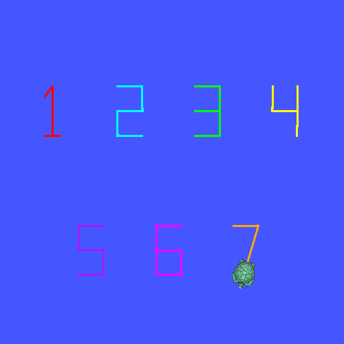
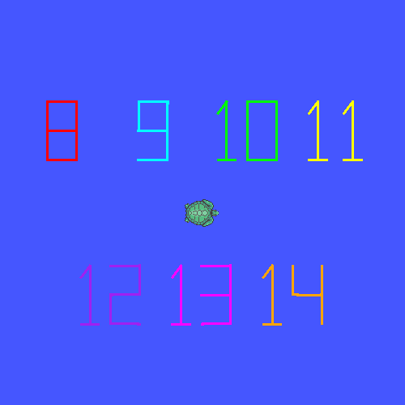
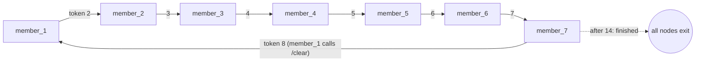

<h1 align="center">Distributed Digit Relay</h1>

<p align="center">
  Seven ROS 2 nodes, one per team member, take turns driving a single turtlesim turtle to draw
  the numbers 1 to 14 over two cycles. Turns pass along a token topic, each stroke stops on
  <code>/turtle1/pose</code> feedback, and member 1 wipes the canvas with <code>/clear</code>
  between cycles.
</p>

<p align="center">
  
  
  
  
</p>

<p align="center">
  <a href="#how-it-works">How it works</a> ·
  <a href="#team">Team</a> ·
  <a href="#build-and-run-ubuntu-2404-ros-2-jazzy">Build and run</a> ·
  <a href="https://github.com/luminolous/Distributed-Digit-Relay-Turtlesim/issues">Report an issue</a>
</p>

<p align="center">
  
</p>

| Cycle 1 (1–7) | Cycle 2 (8–14) |
|:---:|:---:|
|  |  |

## How it works



- **Turn token**: `digit_relay_interfaces/TurnToken` on `/relay/turn`, carrying
  `current_number`, `active_member`, `cycle`, and `finished`. A node stays idle until
  `active_member` matches its own ID.
- **Startup handshake**: every node announces itself on `/relay/ready`. Member 1 sends the
  first token once all 7 are ready, so launch order does not matter.
- **Motion**: the pen goes up (`off: 1`) and the turtle teleports between slots. Strokes are
  drawn with `cmd_vel` in closed loop, and each move stops once `/turtle1/pose` shows the
  target is reached.
- **Cycles**: member 1 calls `/clear` before drawing 8. After 14, member 7 publishes
  `finished` and every member node shuts down cleanly.

## Team

| Member | GitHub | Numbers | Pen |
|:---:|---|:---:|---|
| 1 | [luminolous](https://github.com/luminolous) | 1, 8 | red |
| 2 | [wraphierdz](https://github.com/wraphierdz) | 2, 9 | cyan |
| 3 | [sultanhamdi](https://github.com/sultanhamdi) | 3, 10 | green |
| 4 | [cheskyy](https://github.com/cheskyy) | 4, 11 | yellow |
| 5 | [Paibull](https://github.com/Paibull) | 5, 12 | purple |
| 6 | [RXhy](https://github.com/RXhy) | 6, 13 | magenta |
| 7 | [jejow](https://github.com/jejow) | 7, 14 | orange |

Each member owns `src/digit_relay/digit_relay/member_<N>.py`. The shared core lives in
`relay_base.py` (token, pen, motion), `layout.py` (slot positions), and `glyphs.py`.

## Build and run (Ubuntu 24.04, ROS 2 Jazzy)

From the repository root:

```bash
source /opt/ros/jazzy/setup.bash
colcon build --symlink-install
source install/setup.bash
ros2 launch digit_relay relay.launch.py
```

A full relay takes about 2.5 minutes. The turtlesim window stays open after 14; close it with
Ctrl+C. Add `draw_mode:=teleport` to the launch command for a fast run without closed-loop
motion.

Test one member on its own (two terminals, both sourced):

```bash
ros2 run turtlesim turtlesim_node
ros2 run digit_relay member_4 --ros-args -p solo:=true
```

Solo mode draws the cycle 1 number, clears the canvas, draws the cycle 2 number, and exits.

Layout checks (canvas bounds and slot spacing), no ROS needed:

```bash
python3 -m pytest src/digit_relay/test
```

<details>
<summary>macOS with Pixi / RoboStack Jazzy</summary>

Activate the environment in every terminal instead of sourcing `/opt/ros/jazzy/setup.bash`:

```bash
cd ~/ros_ws && pixi shell
cd ~/Distributed-Digit-Relay-Turtlesim
colcon build --symlink-install
source install/setup.zsh
```

- `error: option --editable not recognized`: run `pixi add 'setuptools<80'` in `~/ros_ws`
  ([colcon-core #696](https://github.com/colcon/colcon-core/issues/696)).
- `colcon test` fails with pytest 9: run `pixi add 'pytest<9'`.
- All terminals must use the same `ROS_DOMAIN_ID` and middleware.

</details>
